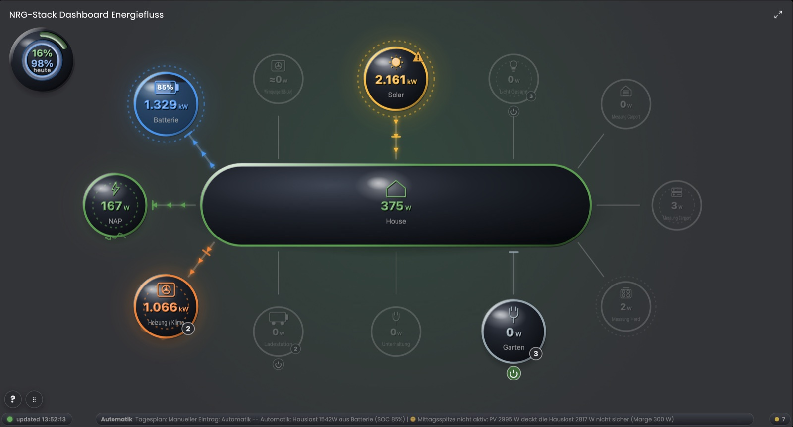
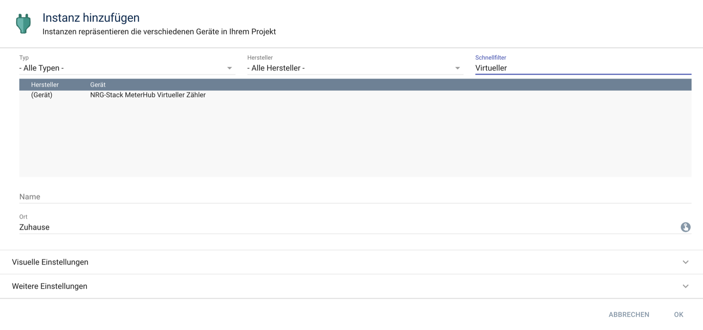
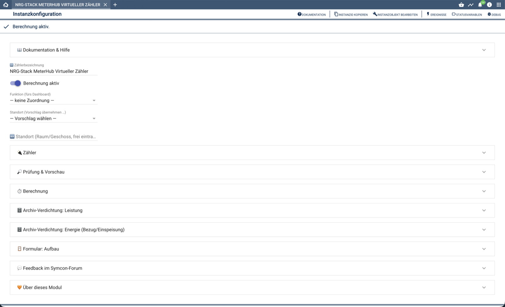
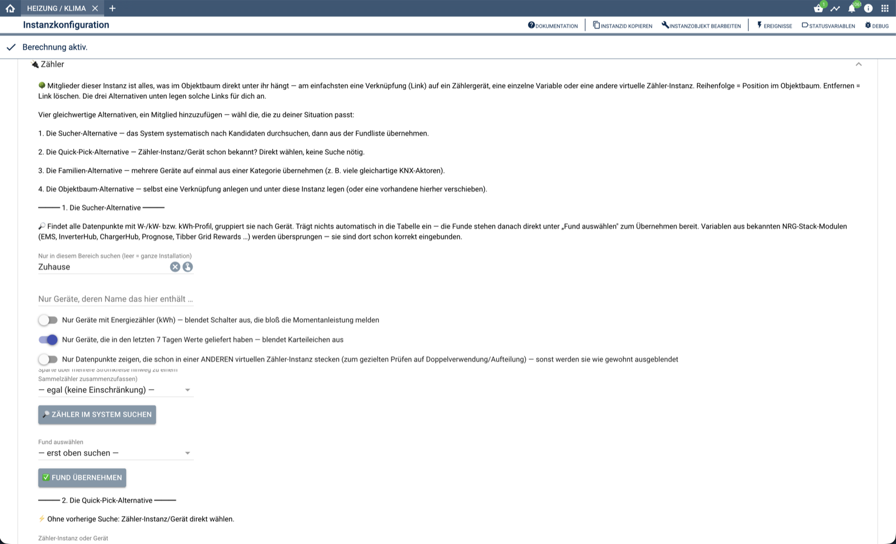
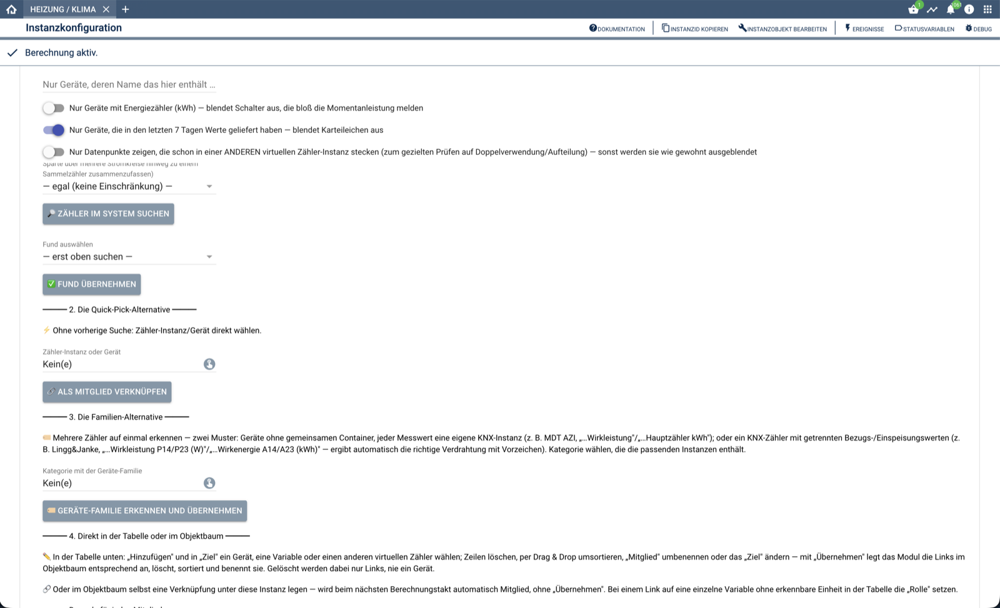
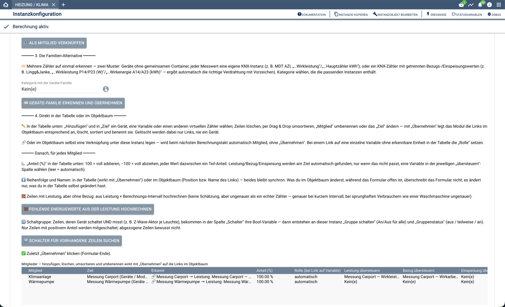
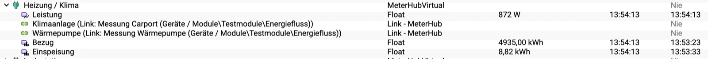
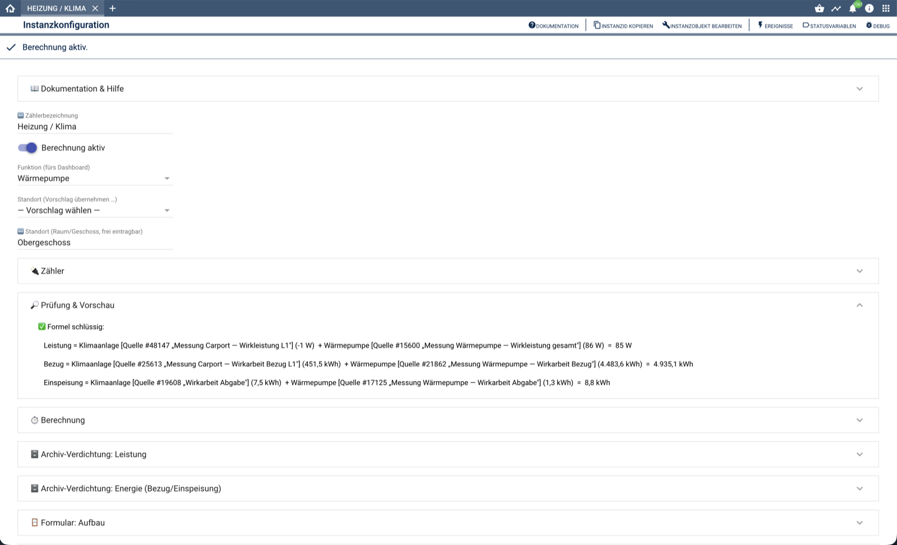
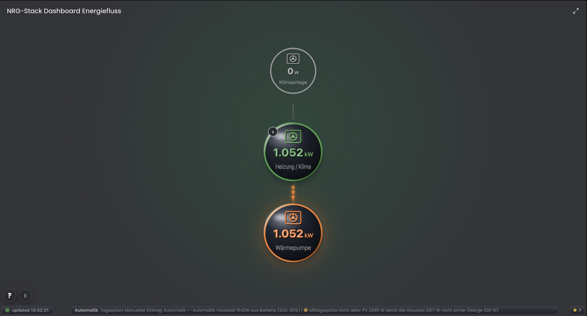
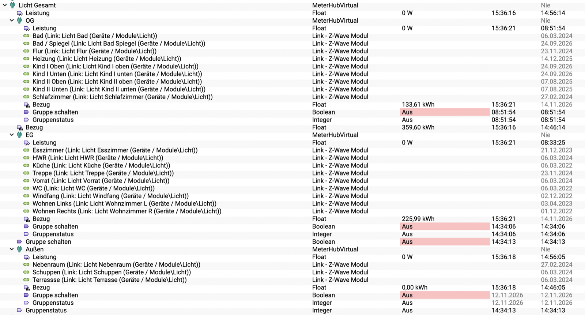

# Zähler-Gruppen: viele Zähler, ein Knoten im Energiefluss

**Der schnellste Weg zu einem aufgeräumten Energiefluss.** Statt dutzende Einzelzähler im Dashboard zu
zeigen, fasst du sie zu Gruppen zusammen und klappst sie bei Bedarf wieder auf. Verbrauch je Raum, Geschoss,
Mietpartei oder Gerätegruppe auf einen Blick, und Licht oder Steckdosen einer Gruppe schaltest du mit einem
Klick. **Ohne Formel und ohne Eintrag im Dashboard.**

Ein Beispiel: Du hast eine Klimaanlage und eine Wärmepumpe mit je einem eigenen Messzähler. Im Energiefluss
soll dafür **ein** Knoten „Heizung / Klima" stehen. Ein langer Druck darauf klappt die Gruppe auf und zeigt die
einzelnen Geräte, auf Wunsch mehrere Ebenen tief.

So funktioniert es: Du legst einen virtuellen Zähler an, sortierst die Zähler im Objektbaum darunter ein und
gibst dem virtuellen Zähler eine Funktion. Das Dashboard findet ihn von selbst.

Auf Ebene 1 steht der Knoten **„Heizung / Klima"** unten links, mit einem Abzeichen „2". Die Zahl nennt,
wie viele Mitglieder er enthält. Das Dashboard blendet die Mitglieder einer Gruppe auf Ebene 1 selbst aus,
damit nichts doppelt gezählt wird.

## Der Assistent führt dich durch

Seit Version 0.38.0 gibt es im virtuellen Zähler ganz oben das Panel **„🧭 Assistent: virtuellen Zähler
zusammenstellen"**. Du wählst, was du tun willst:

- **Zähler zu einer Gruppe zusammenfassen (addieren):** Das ist der Fall dieser Anleitung.
- **Einen Rest berechnen (Zähler abziehen):** zum Beispiel der Haushalt ohne den Unterzähler einer Mietpartei.
- **Einen Zähler anteilig aufteilen:** zum Beispiel 60 % und 40 % auf zwei Mieter.

Darunter wählst du einen Zähler oder ein Gerät und klickst **„Als Summand verknüpfen"** (100 %) oder
**„Als Abzug verknüpfen"** (−100 %). Der Anteil wird für dich gesetzt, du musst ihn nicht mehr in der Tabelle
ändern. Das Panel ist aufgeklappt, solange die Instanz höchstens ein Mitglied hat, und klappt danach zu. Du
kannst es jederzeit wieder öffnen.

**Aus jedem MeterHub-Zähler heraus:** Im Panel „Virtueller Zähler" eines MeterHub-Zählers (auch bei
Inexogy/Discovergy) legt der Knopf **„Virtuellen Zähler mit dem Assistenten anlegen"** eine neue Instanz an.
Dieser Zähler ist dort schon Mitglied, weitere Zähler wählst du in der Liste direkt dort oder später im
Assistenten. Die Zähler dürfen aus **jedem Modul** stammen, zum Beispiel ein Homematic-Energiezähler, nicht nur
aus MeterHub.

## Was du vorher brauchst

- Je Gerät eine **MeterHub-Instanz**, die Leistung (und möglichst Bezug) liefert. Egal ob Modbus,
  Tasmota, Shelly oder Cloud: Der Weg spielt keine Rolle.
- Das **NRG-Stack Dashboard** mit der Energiefluss-Kachel (`NRGDashboardTile`).

## Schritt für Schritt

### 1. Virtuellen Zähler anlegen

In der Konsole eine Instanz hinzufügen: Im **Schnellfilter** „Virtueller" eingeben, dann erscheint
**„NRG-Stack MeterHub Virtueller Zähler"**. Auswählen und mit „OK" bestätigen. Das Feld „Name" darfst
du leer lassen, den Namen setzt du gleich im Formular.

Danach öffnet sich das Formular der neuen Instanz. Oben stehen vier Felder:

- **Zählerbezeichnung:** der Name des Gruppenknotens, hier **„Heizung / Klima"**. Er ist zugleich der
  Name der Instanz im Objektbaum, du musst ihn nicht zweimal pflegen.
- **Berechnung aktiv:** bleibt eingeschaltet. Oben im Formular steht dann „Berechnung aktiv."
- **Funktion (fürs Dashboard):** siehe Schritt 3.
- **Standort:** siehe Schritt 3.

### 2. Die Zähler als Mitglieder einsortieren

Mitglied wird alles, was als **Verknüpfung (Link)** oder direkt **unter der Instanz** im Objektbaum
hängt. Die Reihenfolge im Baum ist die Reihenfolge der Mitglieder. Es gibt mehrere Wege, die Links
anzulegen. Alle stehen im Bereich **„Zähler"** des Formulars:

- **Die Quick-Pick-Alternative (der einfachste Weg):** Im Feld **„Zähler-Instanz oder Gerät"** die
  MeterHub-Instanz des ersten Geräts auswählen und **„🔗 Als Mitglied verknüpfen"** klicken. Das legt
  den Link unter „Heizung / Klima" an. Das Gleiche für die übrigen Geräte.
- **Die Sucher-Alternative:** „Zähler im System suchen", dann bei „Fund auswählen" einen Treffer wählen
  und „Fund übernehmen" klicken.
- **Direkt in der Tabelle:** Unter „Hinzufügen" im Feld „Ziel" ein Gerät wählen.
- **Im Objektbaum selbst:** Eine Verknüpfung anlegen und unter die Instanz ziehen. Sie wird beim
  nächsten Berechnungstakt von selbst Mitglied, ohne „Übernehmen".

Der Bereich „Zähler" beginnt mit einer Übersicht der Alternativen. Darunter folgt die Sucher-Alternative
mit den Filtern und den Knöpfen „Zähler im System suchen" und „Fund übernehmen". Danach kommt die
Quick-Pick-Alternative.

Die Quick-Pick-Alternative im Formular: das Feld **„Zähler-Instanz oder Gerät"** und darunter der Knopf
**„🔗 Als Mitglied verknüpfen"**.

Weiter unten folgen die Hinweise für jedes Mitglied. Ganz unten steht die Tabelle der Mitglieder. Dort kannst du umbenennen, löschen und per Ziehen
umsortieren. Gelöscht werden dabei nur Links, nie die Geräte selbst.

Die Spalten der Tabelle:

| Spalte | Bedeutung |
|---|---|
| Mitglied | Der Name des Links im Objektbaum. Hier änderbar. |
| Ziel | Das verknüpfte Gerät. |
| Erkannt | Was das Modul am Ziel gefunden hat (Leistung, Bezug, Einspeisung). |
| Anteil (%) | 100 = voll addieren, −100 = voll abziehen, dazwischen ein Teil-Anteil. |
| Rolle | Nur bei einem Link auf eine einzelne Variable ohne erkennbare Einheit nötig. |
| … übersteuern | Nur wenn die automatische Wahl nicht passt: eine andere Variable wählen. Leer = automatisch. |

Jedes Mitglied zählt mit **100 %**, die Leistungen werden also addiert. Damit ist „Heizung / Klima" die
Summe der beiden Geräte. Eine Gruppe mit −100 % bei einem Mitglied zieht dessen Wert ab.

So sieht der Objektbaum danach aus. Die Instanz legt außerdem ihre Ergebnisvariablen **Leistung**,
**Bezug** und **Einspeisung** an:

Zuletzt im Formular **„Übernehmen"** klicken.

### 3. Dem Gruppenzähler eine Funktion und einen Standort geben

Im Feld **„Funktion (fürs Dashboard)"** wählst du die Funktion der Gruppe. Im Beispiel steht dort
**„Wärmepumpe"**: Nach der Funktion richten sich Farbe und Einordnung des Knotens im Dashboard. Danach
**„Übernehmen"**.

Die Funktion setzt du am **Gruppenzähler**. Die Einzelzähler dürfen ihre eigene Funktion behalten: Auf
der ersten Ebene zeigt die Kachel nur den Sammelknoten und blendet die Mitglieder aus.

Optional gibt es den **Standort** (Raum oder Geschoss, im Beispiel „Obergeschoss"). Entweder über
„Standort (Vorschlag übernehmen …)" einen vorhandenen Wert wählen oder im Feld „Standort (Raum/Geschoss,
frei eintragbar)" einen eigenen Text eintragen. Der Standort ist nur zur eigenen Übersicht und ändert
nichts an der Rechnung.

### 4. Prüfen

Im Bereich **„Prüfung & Vorschau"** steht bei einer gültigen Verdrahtung ein ✅ **„Formel schlüssig"**
mit den drei fertigen Formeln für Leistung, Bezug und Einspeisung. Hinter jedem Term steht die Quelle
mit der Objekt-ID und der aktuelle Wert. Ein ❌ nennt genau, was noch fehlt. Typische Fälle sind ein
Mitglied ohne Leistungsvariable oder ein doppelt eingetragener Zähler.

Das Bild oben zeigt den aufgeklappten Bereich: Leistung = 85 W, Bezug = 4.935,1 kWh,
Einspeisung = 8,8 kWh, jeweils als Summe der beiden Geräte.

### 5. Im Dashboard

Im Energiefluss steht nach dem Zentrum ein Knoten **„Heizung / Klima"** mit einem Abzeichen, das die
Zahl der Mitglieder nennt (siehe das Bild oben).

- **Kurzer Klick** öffnet die Detailseite des Knotens.
- **Langer Druck**, bis der Ring komplett grün wird, wechselt die Ebene: „Heizung / Klima" wird zum
  Mittelknoten, die beiden Geräte ordnen sich darum an.
- **Zurück** geht es mit einem langen Druck auf den Mittelknoten. Das kleine „‹" oben links auf dem
  Knoten zeigt die Ebene, in die du zurückkehrst.

Es entstehen keine neuen Einträge im Dashboard. Kommt ein drittes Gerät dazu, legst du den Link unter
„Heizung / Klima", und die Kachel zieht von selbst nach.

## Einen Rest berechnen (Zähler abziehen)

Dieselbe Technik rechnet auch „Hauptzähler minus Unterzähler". Wähle im Assistenten **„Einen Rest berechnen"**, verknüpfe
zuerst den Hauptzähler **„Als Summand"**, danach jeden abzuziehenden Zähler **„Als Abzug (−100 %)"**. Im Bereich
„Prüfung & Vorschau" steht die Formel, zum Beispiel „Hauptzähler − Unterzähler". Das Ergebnis liefert Leistung, Bezug und
Einspeisung als eigene Variablen. Hat der Unterzähler seine Energie in Wh, der Hauptzähler in kWh, meldet die Prüfung
unterschiedliche Einheiten und rechnet bewusst nicht. Dann gleichst du die Einheiten an (beim MeterHub-Zähler gibt es die
Einstellung „Energie in Wh statt kWh ausgeben").

## Gruppen verschachteln

Ein Mitglied darf selbst ein virtueller Zähler sein. So baust du Ebenen: „Kühlen" enthält „Büro" und
„Wohnräume", und beide enthalten je ihre Geräte. Die Kachel schachtelt beliebig tief auf. Kreisverweise
(A enthält B, B enthält A) erkennt MeterHubVirtual und rechnet dann bewusst nicht, statt einen falschen
Wert zu liefern.

Das Beispiel unten zeigt zwei Ebenen: „Licht Gesamt" enthält die Gruppen „OG", „EG" und „Außen" als
Mitglieder, und jede dieser Gruppen enthält ihre Leuchten als Links.

Jede Gruppe legt ihre eigenen Ergebnisvariablen an: **Leistung** und **Bezug**, dazu bei schaltbaren Geräten
**Gruppe schalten** und **Gruppenstatus** (siehe nächster Abschnitt).

## Gruppen schalten

Messen die Geräte nicht nur, sondern lassen sich auch **schalten** (zum Beispiel ein Z-Wave-Aktor je
Leuchte), bietet die Gruppe das gleich mit an. Dafür brauchst du nichts einzurichten, MeterHubVirtual sucht
den Schalter am Gerät von selbst. An jeder Gruppe entstehen zwei zusätzliche Variablen, im Bild oben an
„OG", „EG", „Außen" und „Licht Gesamt":

| Variable | Bedeutung |
|---|---|
| **Gruppe schalten** | Ein/Aus für alle Mitglieder der Gruppe auf einmal. |
| **Gruppenstatus** | Zeigt, ob alle Mitglieder aus sind, nur einige oder alle an (Aus / teilweise / An). |

So gehst du vor:

- **Ein- und Ausschalten:** Die Variable „Gruppe schalten" lässt sich wie jeder andere Schalter bedienen,
  auch aus einem Skript. Bei einer verschachtelten Gruppe wie „Licht Gesamt" zählt jede Untergruppe als ein
  schaltbares Mitglied der übergeordneten Gruppe.
- **Welche Mitglieder mitgeschaltet werden:** Nur solche mit positivem Anteil (zum Beispiel 100 %). Ein
  Mitglied, das du mit −100 % abziehst, wird bewusst nicht mitgeschaltet.
- **Wenn ein Schalter nicht gefunden wird:** Im Bereich „Zähler" des Formulars gibt es den Knopf
  **„Schalter für vorhandene Zeilen suchen"**. Er trägt die Schaltvariable des Geräts nach. Gibt es am
  Gerät mehrere Schalter, wählt das Modul den mit der Kennung „StatusVariable" (Z-Wave-Aktoren haben sie), sonst meldet es eine
  Warnung.
- **Im Dashboard** erscheint unter dem Knoten der Gruppe ein kleiner Ein/Aus-Knopf. Im Energiefluss-Bild
  von oben sieht man ihn zum Beispiel an „Licht Gesamt" und „Garten".

Hat eine Gruppe keine schaltbaren Mitglieder, entstehen die beiden Variablen gar nicht.

## Typische Stolpersteine

| Beobachtung | Ursache und Lösung |
|---|---|
| Gruppe erscheint nicht im Dashboard | Dem Gruppenzähler fehlt die Funktion, oder die Instanz wurde nicht übernommen. Funktion setzen und „Übernehmen" klicken. |
| Summe bleibt 0 | Ein Mitglied hat keine Leistungsvariable. Der Bereich „Prüfung & Vorschau" nennt es. |
| Wert zu niedrig | Ein Gerät ist doppelt als Mitglied eingetragen oder fehlt. Die Prüfung meldet doppelte Datenpunkte. |
| „Ziel fehlt" in der Tabelle | Das verknüpfte Gerät wurde gelöscht. Link entfernen oder auf ein neues Gerät zeigen lassen. |
| Gruppe und Einzelgerät erscheinen beide auf Ebene 1 | Das Gerät hängt noch an einer weiteren Stelle mit eigener Funktion. Der Debug-Kanal „Aufschachteln" an der Kachel zeigt, warum ein Knoten ein- oder ausgeblendet wird. |
